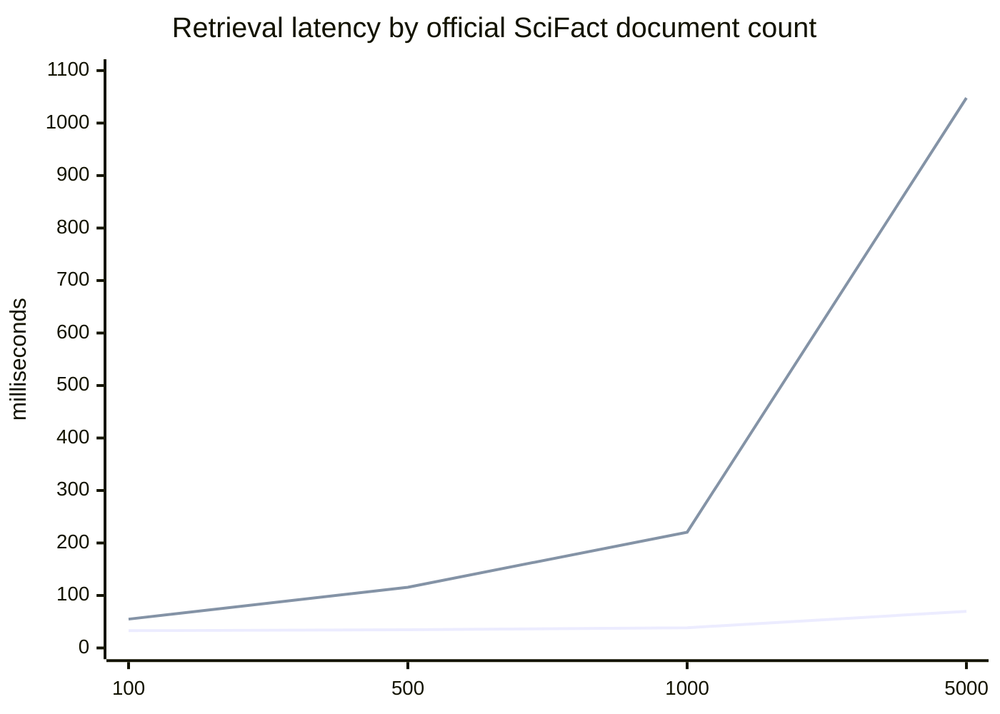
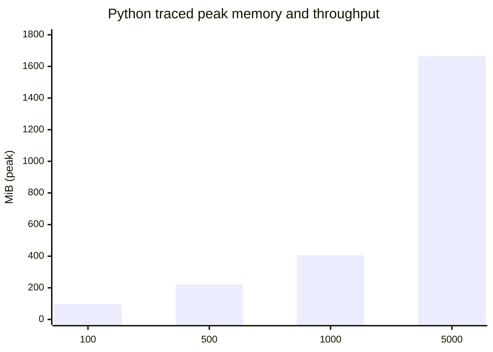

# KAIROS V2.1 engineering hardening report

## 1. Executive summary

KAIROS V2.1 preserves the streaming QueryFrame → PSRC → EFIS → hybrid retrieval → evidence graph → grounding → selective-delta architecture. It hardens five weak points found in V2: EFIS now records separate semantic, evidence, constraint, topic, and request-objective signals; evidence admission requires objective-term coverage; citations bind to versioned SHA-256 chunk content; session resume and trace access require per-session capability tokens; and microphone finalization ignores stale recognizer callbacks and cancels pending timers.

Evaluation was expanded to 100 explicit EFIS pairs, 48 SQuAD labels, the official SciFact test qrels that intersect the committed 12-document subset, 13 grounding adversaries, 100/500/1,000/5,000-document scale points, 1/2/4/8-session concurrency, and a short 40-session soak. The final development benchmark is reproducible and all configured gates except G2 pass.

The results are deliberately not summarized as an overall score. Relevant-evidence precision improved from 0.5789 to 0.8750, and EFIS false merges fell from 0.2241 to 0.1207 on the new pair set. However, EFIS merge recall fell from 0.6190 to 0.5476, its F1 moved from 0.6420 to 0.6389, G2 remains 0.6875 versus 0.80, expanded SQuAD Recall@5 is 0.8125, and the lexical firewall still accepts negated/modal claims. Real microphone hardware and hosted HTTPS/WSS were not available to this agent and remain operator checks.

## 2. Git revision and environment

- Baseline revision: `fc98d57d807b17ffce2b1f9f12ed384dbf0c5315` (`origin/main` at the start of V2.1 work).
- Preserved pre-hardening evidence: `runs/baselines/v2.1-pre-hardening/`, including input hashes, environment, tests, builds, replays, and exact benchmark JSON.
- Final reports: development `20261018T154934Z`, semantic `20261018T154338Z`, hardening `20261018T154238Z`.
- OS: Windows 11 Home Single Language 10.0.26200.
- CPU: Intel Core i9-14900HX, 24 physical cores / 32 logical processors.
- RAM: 16,869,548,032 bytes (15.71 GiB).
- Runtime: Python 3.13.5; Node 22.17.1; npm 10.9.2.
- Default synthesis: deterministic extractive; no LLM calls and zero LLM tokens in the benchmark.
- Default index: BM25 + LSA dense retrieval, reciprocal-rank fusion, deterministic reranking, sparse TF-IDF deduplication.
- Timing: `time.perf_counter`; transcript times are benchmark-assigned; wall timings are machine-specific and were not normalized.
- Reproducibility: seed 42 where sampling applies, immutable dataset revisions, config/corpus hashes and runtime fields embedded in each report. Reports correctly flag that the working tree can be dirty because they are produced before the final commit.

## 3. Files changed

### Backend

- `kairos/decomposer/efis.py`: structured merge signals, objective compatibility, topic/constraint guards, and auditable reasons.
- `kairos/retrieval/index.py`: objective coverage grading, stronger relevance admission, and bounded fallback for low-confidence domain routing.
- `kairos/corpus/ingest.py`, `kairos/engine.py`, `kairos/grounding/firewall.py`: SHA-256 content identity, strict missing-checksum rejection, and explicit legacy SHA-1 compatibility.
- `kairos/session/store.py`, `kairos/api/server.py`: cryptographic session capabilities, guarded resume/trace/delete, restrictive default CORS, and hardening-report endpoint.
- `kairos/corpus/adapters/scifact_eval.py`, `kairos/__main__.py`: paginated official qrels/query import and new evaluation commands.

### Evaluation

- `benchmark/runner.py`: provenance, per-decision PSRC rows, reliability bins, Brier/ECE, prefix-length slices, coverage counts, and review-ready claim audit CSV.
- `benchmark/semantic_runner.py`: 100-pair EFIS comparison, expanded external retrieval evaluation, PSRC comparators, and 13-case grounding audit.
- `benchmark/hardening_runner.py`: pinned official-corpus scale, concurrency, isolation, RSS/tracemalloc, and short-soak measurement.
- `benchmark/datasets/heldout/efis_pairs_v2_1.json`: 100 explicit project-authored pairs. This is not an independently annotated public test set.
- `tests/test_v2_semantics.py`, `tests/test_api.py`, `tests/test_transcript_ingestion.py`: regression coverage for paraphrase merging, pair-set scale, qrels isolation, checksums, session authorization, and resume behavior.
- `runs/bench/`: measured canonical reports, security audit output, traces, and human-review sheet.

### Corpus

- `corpus/imported/scifact/scifact-qrels-test.jsonl` and `evaluation-manifest.json`: official test labels joined only to indexed document IDs.
- `corpus/imported/squad_v2_1/`: 21 contexts and 48 evaluation labels; questions/answers remain outside retrieval.
- No benchmark labels were added to retrievable Markdown.

### Configuration

- `configs/default.yaml`: objective compatibility, semantic-objective merge, minimum objective coverage, low-confidence routing threshold, and expanded corpus profiles.
- `pyproject.toml`, `requirements.txt`: `psutil` added to development/runtime setup for cross-platform RSS measurement; the benchmark still reports unavailable rather than inventing RSS when it is absent.
- `.gitignore`: generated timestamped hardening runs and transient benchmark/download artifacts are excluded; canonical `latest.json` evidence remains tracked.

### Frontend

- `VoiceTranscriptInput.tsx`: cancellable finalization/restart timers and stale-recognizer guards.
- WebSocket transport/event schemas: capability-token resume protocol.
- Benchmark data, panel, route, and bundled fixtures: V2.1 semantic, EFIS, official-label, scale, concurrency, and limitation-aware displays.
- `web/package-lock.json`: compatible audit fix; no forced major-version migration.

### Documentation

- `README.md`, `GUIDE.md`, `docs/CORPUS_PROVENANCE.md`, and this report are updated with measured V2.1 results, commands, dataset licenses, citations, and limitations.

## 4. Algorithms modified

### EFIS merging

For candidate need `q` and existing intent `i`, V2.1 separately calculates semantic equivalence `s`, evidence-footprint RBO `e`, footprint validity `v`, constraint compatibility `c`, topic transition `t`, and request-objective compatibility `o`. A candidate is never merged merely because two broad-domain retrievals overlap.

```text
merge_score = 0.65*s + 0.25*e + 0.10*lexical_overlap
MERGE only if c and not t and (
  validated-footprint rule, or
  high semantic equivalence with compatible objective
)
```

Each decision emits its signals and a reason such as `SEMANTIC_OBJECTIVE_EQUIVALENCE`, `TOPIC_TRANSITION`, or `INSUFFICIENT_EQUIVALENCE`. The thresholds remain configurable. This fixed the documented cancellation paraphrase but intentionally favors avoiding false merges; the 100-pair recall tradeoff is reported below.

### PSRC decision-making

The controller itself was not replaced or tuned on development labels. It continues to derive predicted stability `ŝ` from result stability `ρ`, clarity `χ`, completeness `κ`, slot stability `σ`, continuation `π`, and novelty `ν`, and compares it with the cost threshold:

```text
θ = 1 - λL·H / (λC·Cr + λN·N)
RETRIEVE when ŝ ≥ θ; REFINE when a retrieved query changes materially
```

V2.1 adds a machine-readable row for every candidate decision, its query prefix, signals, threshold, budget, reason, first eligible time, first actual retrieval time, final evidence-survival label, calibration bins, Brier score, ECE, and short/medium/long-prefix slices. No dev-set recalibration was fitted: Brier = 0.2038 and ECE = 0.2331 over 92 diagnostic rows.

### Evidence admission and domain routing

Retrieval now grades every hit from 0–3 and requires both total relevance and objective-term coverage. Generic words such as “policy” or “information” cannot alone admit a same-domain passage. High-confidence domains constrain candidate documents; confidence below 0.25 permits a bounded cross-domain fallback to avoid silently losing novel topics. The rejected 0.35 objective-coverage setting reached 1.00 engineering precision but reduced the original external SQuAD Recall@5 from 0.8333 to 0.7500, so 0.30 was retained.

### Grounding verification

New claims bind every cited chunk as `sha256:<64 hex>` under scheme `sha256-v1`. Verification rejects nonexistent IDs, IDs not retrieved in the session, absent checksums, or content mismatches before quote/anchor/support checks. Unprefixed 64-character SHA-256 and 40-character SHA-1 values remain read-compatible for old traces; all new output is SHA-256. A valid ID with a checksum for stale content is therefore invalid, not merely low-confidence.

### Extractive answer selection

The extractive path remains sentence-focused: candidate sentences come only from admitted evidence, retain their verbatim source span, pass numeric/name anchors and support thresholds, and expose conflicts rather than selecting a convenient value. The focus ablation was neutral on the current two-claim conflict demo (1.0 direct-focus rate in both arms), so no unsupported improvement is claimed.

## 5. Before-and-after results

### Development and semantic evaluation

| Metric | V2 / comparison | V2.1 | Direction |
|---|---:|---:|---|
| Early retrieval rate (G2 target 0.80) | 0.6875 | 0.6875 | unchanged, **fails G2** |
| Premature retrieval rate | 0.3077 published V2 | 0.2963 | slightly better |
| Evidence survival | 0.7231 published V2 | 0.7333 | slightly better |
| Intent recall (development) | 0.9444 | 0.9444 | unchanged |
| Intent precision (development) | 0.9189 published V2 | 0.8947 | worse |
| Intent-count accuracy | 0.9231 published V2 | 0.8846 | worse |
| Relevant-evidence precision | 0.5789 | 0.8750 | better |
| Engineering Recall@5 / MRR | 1.0000 / 1.0000 | 1.0000 / 1.0000 | unchanged |
| Original SQuAD Recall@5 / MRR, 12 labels | 0.8333 / 0.7500 | 0.8333 / 0.7500 | unchanged |
| Expanded SQuAD Recall@5 / MRR@10, 48 labels | not measured | 0.8125 / 0.7639 | new |
| Expanded SQuAD nDCG@10 | not measured | 0.8799 | new |
| Official SciFact Recall@5 / MRR@10 | no qrels | 1.0000 / 1.0000 | only **1** intersecting query |
| EFIS pair accuracy, 100 cases | 0.7100 | 0.7400 | better |
| EFIS merge precision | 0.6667 | 0.7667 | better |
| EFIS false-merge rate | 0.2241 | 0.1207 | better |
| EFIS merge recall | 0.6190 | 0.5476 | worse |
| EFIS merge F1 | 0.6420 | 0.6389 | slightly worse |
| Grounding adversarial accuracy, 13 cases | 0.5385 weak-check arm | 0.8462 | better |
| False grounding acceptance | 0.6000 weak-check arm | 0.2000 | better, not solved |
| Delta refinement correctness | 0.8000 guard-off arm | 1.0000 | better |
| Telemetry coverage | 1.0000 | 1.0000 | unchanged |
| Reproducibility delta | 0 | 0 | unchanged |

The official SciFact result is not a general SciFact score. The committed 12-document subset intersects the official test qrels in exactly one query; its Wilson 95% interval is [0.2065, 1.0]. Expanded SQuAD Recall@5 has Wilson 95% interval [0.6806, 0.8981].

### PSRC comparator arms

| Policy | Early | Premature | Survival | Retrievals / need |
|---|---:|---:|---:|---:|
| V2 PSRC | 0.6875 | 0.2963 | 0.7333 | 1.9615 |
| V2.1 PSRC | 0.6875 | 0.2963 | 0.7333 | 1.9615 |
| Fixed 4 tokens | 0.9375 | 0.2941 | 0.7235 | 2.3462 |
| Fixed 8 tokens | 0.6250 | 0.2000 | 0.7867 | 1.7692 |
| End of utterance | 0 | N/A | N/A | 1.4615 |

Fixed-4 passes G2 but costs more retrievals and has lower survival; fixed-8 reduces premature work but misses G2. PSRC was retained and the failed gate was not weakened.

## 6. Experimental methodology

- The development benchmark contains 26 project-authored sessions and 38 annotated questions (36 answerable, 2 unanswerable), runs twice in fresh contexts, and excludes timing from reproducibility equality.
- The 100 EFIS pairs are explicit and category-balanced enough to expose error classes, but were authored in this repository and are not independent or crowd-adjudicated. V2 and V2.1 are run over the identical file.
- SQuAD uses revision `7b6d24c440a36b6815f21b70d25016731768db1f`; 48 questions map to 21 indexed contexts. Questions, answers, and offsets are labels only.
- SciFact corpus revision is `b3b5335604bf5ee3c4447671af975ea25143d4f5`; qrels revision is `2938d17dc3b09882fdb8c12bbbe2e2dc0e75a029`. The importer paginates official Dataset Viewer rows and joins namespaced IDs without indexing queries/qrels.
- The progressive scale study uses the first N records from the immutable official SciFact Parquet file (SHA-256 `243324b35f03d82bd6d98a5f575966876e86cad7ce16e5333a35b1b793dc4f45`). It does not clone or synthesize documents. Five fixed queries are executed four times per size; percentile estimates therefore have only 20 samples and should be treated as diagnostic.
- Concurrency uses independent real `SessionEngine` instances replaying `pune-demo` against a shared immutable context. The soak is 10 rounds × 4 sessions; it is a short automated check, not production endurance testing.
- The automatic claim judge is independent of the firewall but remains lexical. The audit CSV is ready for human labels; zero claims have been human-reviewed.

## 7. Error analysis

| Input | Expected | Actual | Root cause | Fix or remaining limitation |
|---|---|---|---|---|
| E012: “booking regulations?” / “booking policy.” | merge | split | lexical/semantic score below threshold | alias coverage remains incomplete |
| E021: “call off my booking?” / “cancellation policy…” | merge | split | first phrase classified as topic transition | expand cancellation paraphrase representation without lowering global guard |
| E035: “When was Notre Dame founded?” / “Who founded…” | split | merge | same entity/evidence overwhelms request-objective distinction | stronger question-role objective features needed |
| E072: room for 30 / room for 300 | split | merge | numeric constraint conflict not captured as incompatible | promote numeric slot conflicts into the constraint gate |
| E075: “Pune workshop venue” paraphrase | merge | split | evidence validates but objective score is too weak | improve noun-phrase objective normalization |
| E081: `cancelation` / `cancellation` | merge | split | ASR/spelling variant changes semantic/topic features | add conservative spelling normalization |
| E087: “20 people” / “No, … 40 people” | dataset says split | merge | repair language is treated as refinement of one intent | annotation is arguable; independent adjudication required |
| E099: long 30-person Pune venue paraphrase | merge | split | long-form evidence overlap passes but objective compatibility does not | long-query semantic normalization remains weak |
| SQuAD `5733ae...`: academic-profile rank | retrieve expected context | no admitted hit | relevance gate rejects broad rank phrasing | tune only on separate training labels; do not relax globally |
| SQuAD `5733b5...`: 2014 undergraduate count | retrieve expected context | no admitted hit | numeric/objective terms do not clear objective coverage | query-to-section objective matching remains limited |
| Negated supported sentence | reject | `SUPPORTED` | lexical entailment cannot model negation | use an optional calibrated NLI verifier or explicit negation rule |
| Unsupported modality (“might always”) | reject | `SUPPORTED` | terms and quote are present despite changed modality | modality/quantifier reasoning is not implemented |

Additional misses are retained in `runs/bench/semantic/latest.json`, including seven more expanded-SQuAD misses and the complete 100-pair confusion rows.

## 8. Scaling results

| Documents | Chunks | Build time | RSS delta | Python traced peak | Search p50 / p95 / p99 | Single-session QPS |
|---:|---:|---:|---:|---:|---:|---:|
| 100 | 233 | 15.31 s | 120.1 MiB | 97.7 MiB | 32.9 / 54.9 / 54.9 ms | 27.44 |
| 500 | 1,148 | 11.88 s | 90.7 MiB | 221.2 MiB | 34.7 / 115.7 / 115.7 ms | 18.57 |
| 1,000 | 2,311 | 24.45 s | 161.5 MiB | 406.8 MiB | 38.5 / 220.5 / 220.5 ms | 12.83 |
| 5,000 | 11,732 | 114.20 s | 371.2 MiB | 1,664.0 MiB | 69.7 / 1,047.9 / 1,047.9 ms | 3.77 |





All concurrency arms preserved session isolation. Throughput was 1.873, 4.880, 4.739, and 4.763 sessions/s for 1, 2, 4, and 8 concurrent sessions. The short 40-session soak took 8.526 s and ended 184,320 RSS bytes above its start. The index is memory-only; disk size is `NOT_IMPLEMENTED`, not zero. The 5,000-document p95 is not production-ready and identifies dense search/dedup scaling as the main constraint.

## 9. Grounding audit

The strengthened firewall passed 11 of 13 adversaries. It accepted valid versioned SHA-256, legacy SHA-1, and unprefixed SHA-256; rejected false quotes, invalid/foreign IDs, bad and missing checksums, empty evidence, and a quote copied from the wrong chunk; and downgraded a wrong number. It failed the negation and modality cases because lexical support is not semantic entailment.

Development coverage reports 38 questions (36 answerable, 2 unanswerable), 34 answered, 2 abstained, 2 unresolved, 46 generated/verified claims, 44 supported claims, 2 conflicting claims, and no invalid emitted claims. The independent judge reports grounded-claim rate, citation precision, and citation recall of 1.0. Those are automatic development results—not human validation. `runs/bench/benchmark/audit_sheet.csv` includes query, intent, claim, citation IDs, source passages, source metadata and automatic verdict columns; human verdict, error type, and reviewer notes are blank. Human-audited claims: **0**.

## 10. Live demonstration

1. Install/build, run `python -m kairos serve`, and open `http://localhost:8000/live` in Chrome or Edge.
2. Click **GO LIVE**, then the microphone. Ask: “Find a Pune workshop venue for 30 people, explain the cancellation policy, and tell me whether catering is available.” Stop once. Observe separate intents, early retrieval decisions, evidence cards, and supported citations.
3. Start a second turn: “Actually, this is for an international event.” Observe `DeltaPlanComputed`, selective re-retrieval, and only dependent claims revised.
4. Start a third turn: “Make that shorter.” Observe `SUPPRESS` and a presentation-only answer version with no retrieval.
5. Ask: “Find current 2BHK listings in Mumbai below 20 lakh.” Observe `OUT_OF_DOMAIN` / insufficient evidence and no supporting citations.
6. Open the evidence graph and select a claim to inspect transcript → intent → retrieval → chunk → claim lineage, including SHA-256 content identity.
7. Open the timeline/telemetry inspector and verify PSRC signals, reasons, parent event IDs, retrieval status, and grounding verdicts.

Browser speech recognition may call a vendor service; Kairos does not claim local ASR and stores no raw audio. The automated lifecycle tests use a simulated browser recognizer. Before a public demo, perform the operator checklist in `GUIDE.md` on the exact HTTPS/WSS deployment and microphone hardware.

## 11. Test logs

| Command | Actual result |
|---|---|
| `python -m compileall -q kairos benchmark` | passed |
| `python -m pytest -q` | 44 passed, one third-party `pytz` deprecation warning |
| `python -m kairos bench --repeats 2` | all configured gates pass except G2; reproducibility delta 0 |
| `python -m kairos semantic-bench` | completed; run `20261018T154338Z` |
| `python -m kairos hardening-bench --max-documents 5000` | completed through 5,000 official documents; run `20261018T154238Z` |
| `npm --prefix web run typecheck` | passed |
| `npm --prefix web run build` | passed; Vite built 3,138 modules |
| Recorded Cypress acceptance | 10/10 passed |
| Live backend/WebSocket + simulated microphone Cypress | 3/3 passed |
| `npm --prefix web run build-storybook` + Storybook Cypress | build passed with dependency warnings; 6/6 stories passed |
| Five canonical `python -m kairos replay ...` runs | all passed; lineage coverage 1.000 (110/110, 68/68, 37/37, 25/25, 111/111) |
| `npm --prefix web audit --omit=dev --json` | 0 production vulnerabilities |
| `npm --prefix web audit --json` | 7 dev-only findings: 5 moderate, 2 high |
| `python -m pip check` | host environment has unrelated global-package conflicts; see `runs/bench/security/pip-check.txt` |

The live Cypress run includes an actual FastAPI/WebSocket service but a simulated browser speech-recognition API. It is not a real-microphone hardware result.

## 12. Remaining limitations

- G2 remains failed: 0.6875 early retrieval versus target 0.80. Fixed-4 passes but increases retrieval work and reduces survival, so the target was not weakened and PSRC was not replaced.
- EFIS improves precision and false merges but worsens recall, false splits, and F1. The pair set is project-authored, not independently annotated, and E087 illustrates label ambiguity.
- Development intent precision and count accuracy are lower than the previously published V2 run.
- Evidence precision is 0.875, not perfect; expanded SQuAD misses 9 of 48 expected contexts at rank 5.
- The official SciFact number has an unusably small denominator (one matching qrel) and must not be generalized.
- The firewall remains lexical and fails negation/modality semantics. The automatic judge is not a human audit.
- The 5,000-document index needs about 1.66 GiB of traced Python peak memory and reaches 1.05 s p95 on only 20 timed queries; it is in-memory and has no persistence-size measurement.
- The concurrency run exercises async session isolation on one process, not distributed load, network backpressure, or multi-worker consistency. The 8.5-second soak cannot establish long-term leak freedom.
- Real microphone hardware, vendor-ASR corrections, background-tab behavior, mobile browsers, and hosted HTTPS/WSS have not been validated by this agent.
- Session capability tokens materially improve isolation but travel in the WebSocket query string for browser compatibility; reverse-proxy access logs should redact query parameters. In-memory sessions/tokens disappear on restart and do not support horizontal scaling.
- CORS defaults are restricted to local development, but production operators must explicitly set `KAIROS_CORS_ORIGINS`, TLS, proxy limits, and log redaction.
- npm production dependencies audit clean, but seven dev-tool findings remain because full remediation requires breaking Cypress/Storybook upgrades. They are not bundled into the production application but should be upgraded and retested separately.
- `pip check` reflects conflicts in the shared user Python installation, not a locked isolated KAIROS environment. A clean virtual environment and pinned lock/constraints file remain recommended deployment work.
- Dataset cards report CC BY-SA 4.0 for the imported corpora; downstream redistribution must preserve attribution/share-alike and review upstream source-specific rights. This report is not legal advice.
